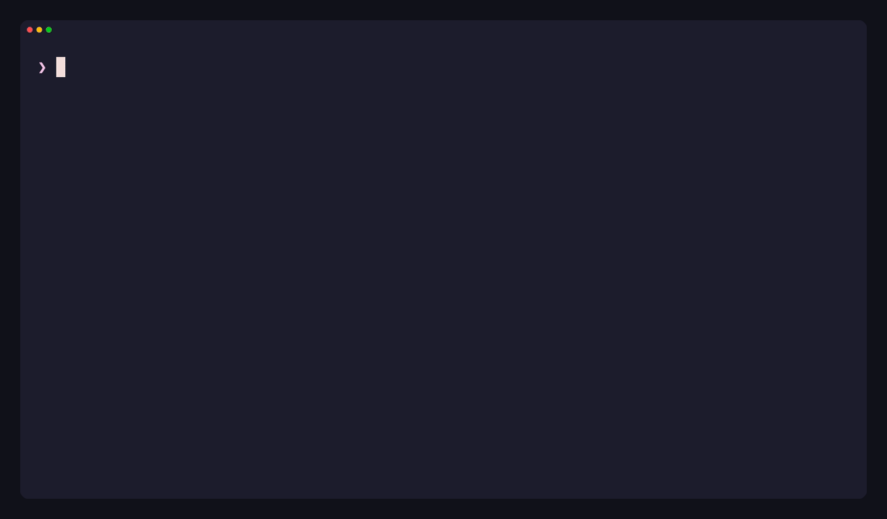

<div align="center">

# ruask

**在终端里问命令：简短命令毫秒级直出，自然语言问题流式回答。**

Ask your terminal how to use a command — instant tldr pages for quick lookups, a streamed LLM answer for everything else.

[官网 / Website](https://ruask.vercel.app) · [快速开始](#快速开始) · [用法](#常用示例) · [配置](#用户配置) · [开发](docs/development.md)




</div>

## 为什么是 ruask

- **简短命令毫秒级**：`ruask tar`、`ruask git commit` 这类只有命令名的查询直接显示本地 tldr 页面，不联网、不需要模型配置。
- **问题交给模型，但带着文档问**：`ruask git commit -q "如何修改上一次提交信息"` 或 `ruask "如何查看占用 8080 端口的进程"` 会把相关 tldr 页面作为参考交给模型，减少编造选项。
- **解释命令输出**：`cat error.log | ruask cargo build -q "为什么失败"` 结合命令、问题和原始输出回答。
- **为终端而做**：流式逐字显示、按语义着色、示例编号、命令从不折行；重定向时输出纯文本，stdout 只含回答。
- **安全的默认行为**：只显示命令、从不执行；常见不可逆命令（递归 `rm`、`git reset --hard`、`git push --force` 等）本地标注警告；不保留对话历史，不加载项目目录的 `.env`。
- **两种协议**：OpenAI 兼容 Chat Completions 与 Anthropic 原生 Messages，环境变量或配置文件切换。

## 快速开始

需要支持 Rust 2024 edition 的 Rust 工具链，支持 macOS 和 Linux。

```sh
git clone https://github.com/KevinGuo1007/ruask
cd ruask
cargo install --path .          # 安装到 ~/.cargo/bin，确保它在 PATH 中

ruask --update-pages            # 可选但推荐：下载并校验官方 tldr 页面
ruask tar                       # 本地页面直出，无需任何配置

ruask --init-config             # 创建配置模板（权限 0600）
# 编辑显示的 config.toml，填入模型服务地址、密钥和模型名
ruask "如何查找大于 100 MB 的文件"
```

也可以只构建不安装：`cargo build --release`，然后运行 `./target/release/ruask`。

### 工作方式

```text
ruask 参数 / stdin
   ├─ 只有命令名、无 -q、无 stdin，且本地有该命令的 tldr 页面 ──► 直接渲染页面（毫秒级，无需网络与凭据）
   └─ 其他查询 ──► 命中命令时附上该命令页和同族相关页作为参考 ──► 流式请求模型 ──► 本地按行渲染
```

### 本地 tldr 页面

```sh
ruask --update-pages                       # 下载官方 tldr.zip，与官方校验文件核对后安装
ruask --update-pages --from ./tldr.zip     # 使用已下载的归档（离线）
```

页面安装到 `$RUASK_TLDR_DIR`，未设置时为 `$XDG_DATA_HOME/ruask/tldr` 或 `$HOME/.local/share/ruask/tldr`，
只保留英文与简体中文页面，并生成供参考检索使用的 `ruask-index.tsv`。安装后：

- 只有命令名、没有 `-q` 和 stdin 的查询（如 `ruask tar`、`ruask git commit`）直接显示本地页面；
  页面只适用于另一个平台时会注明；首词拼写接近唯一页面名时（如 `gti commit`）自动纠正并在 stderr 说明。
  末尾标注来源 `tldr-pages · CC BY 4.0`。
- 其余查询在命令命中页面时，把命令页、同族中与问题最相关的两页以及其余子命令页名作为
  `reference` 交给模型。
- 没有安装页面时，所有查询保持纯模型路径。

页面内容来自 [tldr-pages](https://github.com/tldr-pages/tldr)，按
[CC BY 4.0](https://creativecommons.org/licenses/by/4.0/) 许可使用；ruask 不随包分发页面。

## 常用示例

```sh
ruask cargo
ruask git commit
ruask git commit -q "如何修改上一次提交的信息"
ruask "如何查看占用 8080 端口的进程"
ruask --question "如何查找大于 100 MB 的文件"
ruask -L zh -p linux "如何查看端口占用"
ruask --language en --platform macos launchctl
ruask "git commit --amend"
ruask -- git commit --amend
cat error.log | ruask cargo build -q "为什么失败，下一步如何排查"
ruask git status > usage.txt
ruask --language=en -pmacos launchctl   # 带值选项也可写成 --opt=值 或 -L/-p/-q 紧跟值
ruask --version                         # 版本与本地 tldr 页面状态
ruask -h                                # 简短帮助；--help 为完整帮助，-L en 时为英文
```

## 模型协议与流式行为

`OPENAI_BASE_URL` / `ANTHROPIC_BASE_URL` 是对应协议的基础地址，包含服务所需的路径前缀。程序在后面追加
`/chat/completions`（OpenAI 兼容协议）或 `/messages`（Anthropic 原生协议），
地址末尾有无 `/` 都可以；网关中间路径保持不变，程序不自动补 `/v1`。地址、密钥和模型名称合并后均为必需。

支持 OpenAI 兼容的 Chat Completions 与 Anthropic 原生 Messages 文本接口，默认发送一次流式请求。
说明行和示例用途随到随显示（攒够 8 个字符后开始，未配对的反引号暂缓），命令、标题和围栏内容整行显示；
正常结束时补齐没有换行的最后一行。每次模型请求的总超时为 60 秒。Anthropic 只展示文本内容块，忽略思考、工具与心跳数据；
要求正常结束原因及消息结束事件，生成截断、异常 EOF 和流内错误均不能算成功。

只有服务明确拒绝 stream 能力、且尚未展示回答时，才向相同服务、协议和模型
自动回退一次非流式请求；回退前在 stderr 提醒，失败后不再重试。
流式请求直接收到正常完整 JSON 回答时，直接复用该响应并在 stderr 提醒实际未使用流式，不另发请求。
鉴权、限流/额度、超时、网络和普通参数错误均不作为不支持流式的证据；
已展示部分回答后发生错误，保留已显示内容，标记不完整并以退出码 5 结束，不重放回答。
stdout 仅包含回答，重定向保存时不会混入这些提醒；没有答案缓存或持久能力缓存。

## 用户配置

macOS 和 Linux 均读取 `$XDG_CONFIG_HOME/ruask/config.toml`。
`XDG_CONFIG_HOME` 未设置或为空时使用 `$HOME/.config/ruask/config.toml`；路径必须是绝对路径。
切换工作目录、安装渠道或升级二进制不会改变这份配置。

`ruask --init-config` 显示配置位置并创建模板，不要求模型凭据，也不发送请求。
已有文件保持原样；新文件权限为 `0600`，仅当前用户可读写。编辑其中的 OpenAI 配置即可开始查询：

```toml
api_type = "openai"
# language = "zh" # en / zh（简体中文）；未设置时使用 locale，再回退英文

[openai]
base_url = "https://your-provider.example/v1"
model = "your-model"
api_key = "YOUR_API_KEY"

[anthropic]
base_url = "https://your-anthropic-provider.example/v1"
model = "your-model"
api_key = "YOUR_API_KEY"
```

协议优先级为 `RUASK_API_TYPE` → 文件 `api_type` → `openai`。
`openai` 表示 OpenAI 兼容协议，不根据模型名或服务域名猜测协议。
`anthropic` 使用原生 Messages，请求在顶层发送 `system` 指令、用户消息与 `max_tokens=4096`。
两类协议均默认流式，复用完整行展示；不会因为模型名含 `claude` 改变所选协议。

Anthropic 发送 `Authorization: Bearer <api_key>` 和 `anthropic-version: 2026-10-21`。
使用未绑定单个 workspace 的密钥时，另设 `ANTHROPIC_WORKSPACE_ID`，作为
`anthropic-workspace-id` 请求头；绑定单 workspace 的密钥可省略。该变量只在选中
`anthropic` 时使用，显式空白值在本地报错。只接受旧 `x-api-key` 的网关需要调整其认证兼容性，
程序不会自动猜测另一种认证方式。认证与版本依据
[官方认证说明](https://platform.claude.com/docs/en/manage-claude/authentication)和
[API 版本说明](https://platform.claude.com/docs/en/api/versioning)。

所选协议按字段合并环境变量与文件配置，环境变量优先：

| 协议 | 环境变量 |
| --- | --- |
| `openai` | `OPENAI_BASE_URL`、`OPENAI_API_KEY`、`OPENAI_MODEL` |
| `anthropic` | `ANTHROPIC_BASE_URL`、`ANTHROPIC_API_KEY`、`ANTHROPIC_MODEL` |

仅使用所选协议的字段，不向另一组借用。显式空白环境值报错，不回退到文件。
没有用户文件时，原有的三个 OpenAI 环境变量仍可独立使用：

```sh
export OPENAI_BASE_URL="https://your-provider.example/v1"
export OPENAI_API_KEY="你的密钥"
export OPENAI_MODEL="你的模型名"
ruask cargo
```

程序不自动加载当前目录或父目录的 `.env` 或项目配置，也不修改 shell 启动文件。
无效 TOML 和缺失配置在请求前报错，错误不显示凭据或配置原文。

## 输入和输出约定

结果语言支持 `en`（英文）和 `zh`（简体中文）。优先级为 `-L` / `--language`
→ 用户配置文件的 `language` → locale → 英文。CLI 和文件中显式不支持的语言在本地报错，
不发送模型请求；CLI 的有效选择可以覆盖文件中的语言偏好。

自动选择时，`LANG` 未设置就直接使用英文；否则依次尝试 `LANGUAGE` 的冒号列表、
`LANG`、英文，跳过 C/POSIX 和不支持的候选。编码、区域和修饰信息归一为基础语言，
例如 `en_US.UTF-8` → `en`，`zh_TW.UTF-8` → `zh`；中文统一要求简体。
不使用 `LC_ALL` 或 `LC_MESSAGES` 选择结果语言。

目标平台默认为当前主机，`-p` / `--platform` 接受 `linux`、`osx` 和 `macos`（归一为 `osx`），
无效值在本地报错。请求携带最终语言和平台，并要求模型优先为自然语言任务提供目标平台可用命令。
明确查询的命令若不适用于目标平台，则要求简短注明适用平台后继续解释原命令，不自动替换工具。
本地 HTTP 替身测试只验证请求约束及固定回答展示。真实模型的语言遵从、跨平台命令质量和延迟
按[测试说明](docs/testing.md)检查；历史单服务样本不能代替完整跨协议和主机验收。

| 输入 | 查询语义 |
| --- | --- |
| `ruask cargo` | 已知命令 |
| `ruask git commit` | 多个位置参数组成的子命令 |
| `ruask "如何查看端口占用"` | 自然语言命令行任务 |
| `ruask git commit -q "如何撤销提交"` | 命令查询与附带问题 |
| `ruask --question "如何查看端口占用"` | 独立的具体问题 |
| `ruask tar -xzvf` 或 `ruask git commit --amend` | 命令词之后 ruask 不认识的选项属于目标命令 |
| `ruask "git log -p"` 或 `ruask -- git log -p` | 目标选项与 ruask 选项（`-q`/`-L`/`-p`/`--color`/`-h`/`-V`）重名时 |

多个位置参数用空格连接；需要保留准确的空格或 Shell 特殊字符时，用引号括起查询。
`-q` 与 `--question` 各接收一个字符串，每次调用只能提供一次。命令词之前的未知选项、
问题选项缺值和显式空白查询会在本地报错（退出码 2）；命令词之后的未知选项并入查询。`--` 后所有参数都视为查询内容。

普通命令查询要求模型提供一句简介和约五个常用示例；具体问题要求一至三个相关示例
及简短解释。每个示例包含用途说明与命令，使用类 tldr 的纯文本格式。
模型指令限定为命令行用法与输出解读，不提供通用聊天；程序只在本地 tldr 页面中查找参考，
不联网检索文档、不执行建议命令，不保留跨调用的对话历史。
目标平台就是本机时，请求附带 `environment`：当前 shell、PATH 中可用的包管理器以及所查命令是否已安装
（只检查 PATH 中的可执行文件，不运行任何程序），用于给出本机可用的安装和使用方式。
常见的不可逆命令（递归 `rm`、`git reset --hard`、`git push --force`、`git clean -f`、`dd of=`、`mkfs`、
`chmod -R 777`、`docker system/volume prune`）无论来自页面还是模型，都会在命令下方本地标注警告。测试验证请求契约，实际模型的回答质量取决于所用服务。

`cat error.log | ruask` 默认解释输出含义和明显错误，并给出相关下一步命令；
`cat error.log | ruask cargo build -q "为什么失败"` 同时保留命令目标、附带问题和原始输出上下文，
重点回答问题。输出上下文作为数据传递，保留有效 UTF-8 文本的空格、换行与 Unicode，
输出解读不强行套用五例结构。

有限管道读到 EOF 后发起一次查询，不持续分析日志。stdin 上限为 **65,536 字节（64 KiB）**，
恰好达到允许；多字节文本按 UTF-8 字节数计量。超限在请求前报错，不截断、不自动分段，
也不提供上限调整选项。先用筛选工具或 `tail` 缩小输入再重试，例如：

```sh
tail -n 100 error.log | ruask -q "如何排查这些错误"
```

按行筛选后仍需保证总字节数不超限；没有内容的 stdin 不会产生额外查询。

终端结果按语义着色：标题为加粗紫色，简介使用终端默认前景色（以“注意/警告/Note/Warning”开头的说明为黄色），
用途为绿色、命令为青色，说明中的行内代码为黄色斜体。命令中的 `{{name}}` 占位符在终端里去掉花括号、
显示为斜体加下划线（多选一的 `{{a|b}}` 保留花括号，避免看起来像管道）；关闭颜色或重定向时保留 `{{name}}` 原文，复制后仍能看出需要替换的位置。
红色只用于危险命令警告。tldr 英文页的助记符（如 `[c]reate`）显示为 `create`，终端中 c 带下划线。
简介和用途缩进两格，命令缩进四格，示例组间保留一个空行；这些布局由本地渲染器控制，
不依赖模型是否省略或重复空行。

模型收到明确的行格式约定：`#` 标题、`>` 简介/解释、`-` 示例用途，完整命令用整行反引号标识。
渲染器按行角色解析，去掉显示标记与意外围栏：说明和用途随到随显示，命令整行显示；不会等整份回答结束。
无法识别格式的内容保守地作为普通文本显示，保留原始缩进与空行，不再凭缩进猜测命令。
列表中只有一段整行反引号命令时，也按命令显示；普通说明中的行内代码保持说明样式。
若示例用途缺少独立命令行，保留回答并在 stderr 提醒一次，不为修复格式额外请求模型。
模型自带的 ANSI 颜色及终端控制序列会被过滤，颜色由本地添加；行内强调结束时恢复完整样式，避免斜体延续。
命令的引号与运算符保持原样；重定向仍逐行输出纯文本。

stderr 是终端时，等待模型首行期间显示一行暗色提示 `⠋ 正在询问 <模型>…`（120 ms 内有回答则不显示），
第一行回答出现前清除，不进入 stdout，也不影响重定向。stdin 是管道且 1 秒后仍未结束时，stderr 提示一次
“正在等待 stdin 结束”，常见于上游命令仍在运行或调用方保留了一个不关闭的管道（可加 `</dev/null`）。

模型请求建连（含 TLS 握手）超过 8 秒时，请求尚未发出，自动重新连接一次并在 stderr 说明；整体上限 60 秒；流式请求声明 `Accept-Encoding: identity`，避免服务端或代理
为压缩而合并事件。连接被拒绝、主机无法解析、超时和 TLS 失败会分别给出下一步建议。
首次使用时，若既没有本地页面也没有模型配置，只有命令名的查询会提示运行 `ruask --update-pages`。

stdout 是终端时：说明和用途按终端宽度（至少 30 列）在词间或汉字间折行，续行保持缩进，句末标点不放到行首；
命令从不折行，避免改变复制粘贴的语义；示例用途前显示暗色编号。重定向和管道输出不编号、不折行。
模型回答结束后，若 stderr 是终端，追加一行暗色来源标识（“AI 生成，请核对 · 模型 · 耗时 · 参考 tldr 页面”），不进入 stdout。
默认样式参考 tlrc 的语义角色；当前没有自定义主题入口，也不读取 tldr 的配置文件。

| 颜色选项 | 行为 |
| --- | --- |
| `--color auto`（默认） | stdout 是终端时启用；`NO_COLOR` 非空时关闭 |
| `--color always` | 显式启用，覆盖 `NO_COLOR`，重定向也包含颜色转义 |
| `--color never` | 始终纯文本 |

例如 `ruask git --color never` 禁用颜色；`ruask git > usage.txt` 默认不带颜色。
空值 `NO_COLOR=` 不关闭自动颜色。颜色只影响本地显示，不改变模型协议或流式请求。
帮助与配置初始化位置保持纯文本，错误和兼容提醒仍写 stderr。

- stdout 只包含按行展示的回答，正常结束的最后一行没有换行时补上换行；帮助与配置初始化分别输出帮助和配置位置。
- 无参数且没有 stdin 内容时显示简短帮助，成功退出。帮助与无效输入不需要模型凭据，也不发请求。
- stderr 用于错误信息；已展示部分回答后断流、截断或流内错误时，保留完整行、提示结果不完整并非零退出，不重发另一份回答。
- 角色、空内容、工具和思考数据等非正文不会展示；HTTP 成功本身不代表回答已正常完成。
- 退出码：`0` 成功，`1` 其他错误，`2` 用法或输入错误，`3` 配置错误，`4` 无法连接或服务返回错误，`5` 回答不完整。
- 下游提前关闭输出时安静结束，例如 `ruask git | head -n 1`。

## 配置一次后的完整工作流

模板可同时保存两个协议的设置。填写各组自己的地址、密钥和模型后，在任意工作目录使用：

```sh
ruask --init-config
# 编辑显示的 config.toml，填写 [openai] 与 [anthropic]；已有文件不会被覆盖。
cd /path/to/project-a
ruask git status
ruask git commit -q "如何修改上一次提交的信息"

cd /path/to/project-b
RUASK_API_TYPE=anthropic ruask -q "How can I inspect changes?" -L en -p macos
cat error.log | ruask cargo build -q "为什么失败，下一步如何排查？" -L zh -p linux
ruask git status > usage.txt 2> status.txt
```

上面的协议环境变量只覆盖该次调用。后续未指定时仍遵循文件选择，不需要更换另一组配置。
`usage.txt` 默认只含纯文本回答；兼容提醒和错误进入 `status.txt`。相同的有效查询再次调用时，
仍会在线请求，并从流式开始，不复用旧答案或之前的能力判断。

首版支持 macOS/Linux、英文和简体中文，专注命令速查与有限输出解读。
不提供持续日志分析、命令执行、跨调用历史、在线文档检索、其他云平台专属协议或 Windows 适配。
安装包发布、Homebrew 配方和安装脚本不在本版范围内。

## 代码结构

```text
src/
  main.rs          参数、stdin、执行顺序、输出和退出码
  query.rs         命令查询、语言与 locale 解析、目标平台
  config.rs        用户配置定位、初始化、环境覆盖与字段校验
  model.rs         查询指令、协议选择、一次兼容回退与 OpenAI 回答
  model/compatibility.rs  明确的流式能力证据和安全错误分类
  model/anthropic.rs  原生 Messages 请求、文本块与完成状态
  model/sse.rs     两类协议共用的 SSE 事件帧读取
  output.rs        逐字显示说明与用途、围栏与控制序列过滤、终端折行与编号、颜色、占位符与助记符样式和危险命令标注
  waiting.rs       等待模型首行时的 stderr 提示（仅终端）
  tldr.rs          本地 tldr 页面定位、直出渲染、参考选择、拼写纠正与 --update-pages
  environment.rs   本机 shell、包管理器与命令安装状态（只查 PATH）
  trace.rs         可选阶段计时，只记录单调时间与数值
tests/
  cli.rs           启动真实 CLI，用本地 HTTP 服务代替模型
  config.rs        隔离用户目录，验证配置文件与真实查询
  streaming.rs     受控服务握手、拆片、断流与下游关闭
  anthropic.rs     原生协议请求、内容块与完成状态
  compatibility.rs 两协议回退、JSON 复用和禁止重试的错误
  rendering.rs     伪终端颜色、围栏过滤与逐行渲染
  trace.rs         时间顺序、默认关闭、隐私及错误/回退记录
  thinking.rs      可选推理参数、配置优先级及协议隔离
  tldr.rs          本地直出、跨平台提示、拼写纠正、参考与环境字段、页面安装
  polish.rs        版本、选项写法、首次引导、错误提示、请求头、stdin 与等待提示、助记符
docs/
  development.md  开发入口、模块职责、术语与配置设计
  testing.md      离线回归、质量验收方法及未验证范围
  performance.md  可选观测、推理设置与性能结论的局限
site/             项目官网（Vite + React），部署在 https://ruask.vercel.app
```

建议从 [开发指南](docs/development.md) 开始，再沿着 `main → run` 阅读源码。

## 验证

```sh
cargo test
cargo fmt --check
cargo clippy --all-targets -- -D warnings
```

测试不需要真实模型密钥，会监听本机随机端口；macOS/Linux 的颜色测试还会创建本地伪终端。

离线测试验证客户端契约，不证明模型命令正确率或自然语言理解质量。
真实服务验收、测量定义及未验证范围见[测试说明](docs/testing.md)；不承诺未经实测的固定毫秒延迟。

## 性能观测与可选推理参数

`RUASK_TRACE=1 ruask git status` 会在 stderr 末尾输出一条 `ruask-trace:` JSON，包含单调时间戳、请求大小和 HTTP 状态数值；不记录查询、回答、地址或凭据。默认关闭，stdout 和退出语义保持原样。首条命令标记只表示完整命令候选，正确性需要另行核查。

支持 `thinking.type` 的 OpenAI 兼容服务可使用 `OPENAI_THINKING=disabled ruask git status`，或在 `[openai]` 中保存 `thinking = "disabled"`（也支持 `enabled`）。环境变量覆盖文件；未设置时不发送此参数，原生 Anthropic 协议忽略它。其他服务需先确认支持该扩展。

在支持该扩展的服务上关闭 thinking 通常能明显缩短首字时间；它不是标准参数，默认不发送。观测字段和结果局限见[性能说明](docs/performance.md)。

## 分发与发布状态

仓库支持从源码构建和 `cargo install --path .` 安装。Cargo 包使用明确的文件白名单，包含源码、回归测试、许可证和贡献者文档；检查命令见[开发指南](docs/development.md#打包检查)。

尚未发布到 crates.io，也没有 Homebrew 配方或预编译二进制。

## 许可证

ruask 以 [MIT](LICENSE-MIT) 或 [Apache-2.0](LICENSE-APACHE) 双许可证发布，任选其一。

除非你明确声明，否则你有意提交给本项目的任何贡献，均按 Apache-2.0 许可证的定义，以上述双许可证授权，不附加任何其他条款或条件。

本地 tldr 页面内容来自 [tldr-pages](https://github.com/tldr-pages/tldr)，按 CC BY 4.0 许可使用，不随 ruask 分发。
