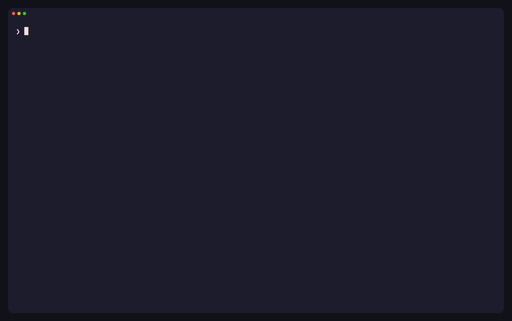
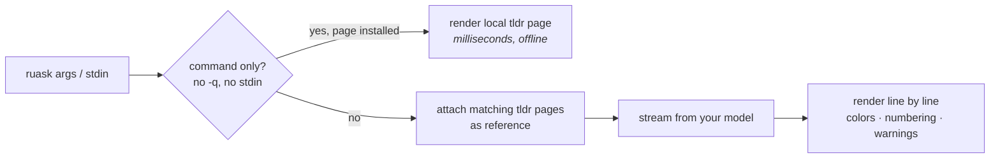

<div align="center">

<a href="https://ruask.vercel.app">
  <picture>
    <source media="(prefers-color-scheme: dark)" srcset="site/public/brand/ruask-wordmark-dark.svg">
    
  </picture>
</a>

<h3>Ask your terminal how to use a command.</h3>

<p>Instant tldr pages for quick lookups. Streamed, reference-backed LLM answers for everything else.</p>

<p>
  <a href="https://ruask.vercel.app"></a>
  <a href="https://github.com/KevinGuo1007/ruask/stargazers"></a>
  <a href="https://github.com/KevinGuo1007/ruask/commits/main"></a>
  <br>
  <a href="#license"></a>
  <a href="https://doc.rust-lang.org/edition-guide/rust-2024/index.html"></a>
  
</p>

<p>
  <b>English</b> · <a href="README.zh-CN.md">简体中文</a>
  &nbsp;|&nbsp;
  <a href="#quick-start">Quick start</a> ·
  <a href="#usage">Usage</a> ·
  <a href="#configuration">Configuration</a> ·
  <a href="docs/reference.md">Reference</a>
</p>



</div>

<br>

## Why ruask

|  |  |
| --- | --- |
| ⚡ **Milliseconds for quick lookups** | `ruask tar` or `ruask git commit` renders the local tldr page directly: no network, no model, no API key. |
| 📚 **Answers grounded in docs** | Questions like `ruask git commit -q "how do I edit the last commit message"` send the matching tldr pages to the model as reference, so it invents fewer flags. |
| 🔍 **Explains command output** | `cat error.log \| ruask cargo build -q "why did it fail"` reads the output, the command and your question together. |
| 🖥️ **Made for the terminal** | Streams as it arrives, colors by meaning, numbers examples, never wraps a command. Redirected output stays plain text. |
| 🛡️ **Safe by default** | Shows commands, never runs them. Flags destructive ones (`rm -r`, `git reset --hard`, `git push --force` …). No history, no project `.env` loading. |
| 🔌 **Bring your own model** | OpenAI-compatible Chat Completions or native Anthropic Messages, configured once per user. |

## Quick start

Requires a Rust toolchain with 2024 edition support, on macOS or Linux.

```sh
cargo install --git https://github.com/KevinGuo1007/ruask

ruask --update-pages      # optional, recommended: download and verify the official tldr pages
ruask tar                 # local page, no configuration needed

ruask --init-config       # create a 0600 config template and print its path
# fill in your model's base_url, api_key and model, then:
ruask "find files larger than 100 MB"
```

<details>
<summary>Build from a clone instead</summary>

```sh
git clone https://github.com/KevinGuo1007/ruask
cd ruask
cargo install --path .    # or: cargo build --release && ./target/release/ruask
```

Make sure Cargo's bin directory (usually `~/.cargo/bin`) is on your `PATH`.

</details>

## How it works



Pages are installed by `ruask --update-pages` into `$RUASK_TLDR_DIR`, or `$XDG_DATA_HOME/ruask/tldr`, or `~/.local/share/ruask/tldr`. Only English and Simplified Chinese pages are kept. Without pages, every query goes to the model as before.

## Usage

| Command | What happens |
| --- | --- |
| `ruask cargo` | Look up a command |
| `ruask git commit` | Look up a subcommand (positional args are joined) |
| `ruask "find the process listening on port 8080"` | Natural-language task |
| `ruask git commit -q "how do I undo a commit"` | Command plus a focused question |
| `ruask --question "how do I watch a log file"` | A question on its own |
| `cat error.log \| ruask cargo build -q "why did it fail"` | Explain piped output (up to 64 KiB) |
| `ruask tar -xzvf` | Unknown options after the command word belong to the target command |
| `ruask -- git log -p` | Use `--` (or quotes) when a target option clashes with ruask's own |
| `ruask -L zh -p linux "check disk usage"` | Pick answer language (`en` / `zh`) and target platform (`linux` / `macos`) |
| `ruask git status > usage.txt` | stdout carries only the answer, as plain text |
| `ruask --version` | Version and local tldr page status |

Run `ruask -h` for short help or `ruask --help` for the full one.

## Configuration

`ruask --init-config` creates `$XDG_CONFIG_HOME/ruask/config.toml` (default `~/.config/ruask/config.toml`) with `0600` permissions and keeps an existing file.

```toml
api_type = "openai"          # or "anthropic"
# language = "en"            # en / zh; defaults to your locale, then English

[openai]
base_url = "https://your-provider.example/v1"   # /chat/completions is appended
model = "your-model"
api_key = "YOUR_API_KEY"
# thinking = "disabled"      # only for services that support thinking.type; usually much faster

[anthropic]
base_url = "https://your-anthropic-provider.example/v1"   # /messages is appended
model = "your-model"
api_key = "YOUR_API_KEY"
```

Environment variables override the file field by field for the selected protocol and never borrow from the other one:

| Protocol | Variables |
| --- | --- |
| selection | `RUASK_API_TYPE` (`openai` / `anthropic`) |
| `openai` | `OPENAI_BASE_URL`, `OPENAI_API_KEY`, `OPENAI_MODEL`, `OPENAI_THINKING` |
| `anthropic` | `ANTHROPIC_BASE_URL`, `ANTHROPIC_API_KEY`, `ANTHROPIC_MODEL`, `ANTHROPIC_WORKSPACE_ID` |

ruask never reads `.env` files from your project and never edits shell startup files. Full details, including streaming fallback rules and the Anthropic headers, are in the [reference](docs/reference.md).

## Output and exit codes

- **stdout** carries only the answer; **stderr** carries notices, the waiting spinner and the source line (model · elapsed time · tldr pages used).
- Color follows `--color auto|always|never` and `NO_COLOR`. Placeholders such as `{{file}}` show as underlined italics in a terminal and stay literal when redirected.
- A stream that breaks after output has started keeps what was shown and exits with `5`. Nothing is retried or replayed.

| Code | Meaning |
| :-: | --- |
| `0` | success |
| `1` | other error |
| `2` | usage or input error |
| `3` | configuration error |
| `4` | connection or service error |
| `5` | incomplete answer |

## Documentation

- [Behavior reference](docs/reference.md): protocols, streaming, configuration, input and output rules (Chinese)
- [Development guide](docs/development.md) · [Testing](docs/testing.md) · [Performance notes](docs/performance.md)
- [Website](https://ruask.vercel.app), with a 20-second launch video

## Development

```sh
cargo test
cargo fmt --check
cargo clippy --all-targets -- -D warnings
```

Tests need no real API key. They start local HTTP stand-ins on random ports and, on macOS/Linux, a pseudo-terminal for color tests. The website lives in [`site/`](site/README.md) (Vite + React) and deploys to Vercel from `main`.

Not yet on crates.io, Homebrew or as prebuilt binaries. Windows is out of scope for now.

## License

ruask is dual-licensed under [MIT](LICENSE-MIT) or [Apache-2.0](LICENSE-APACHE), at your option.

Unless you explicitly state otherwise, any contribution intentionally submitted for inclusion in ruask, as defined in the Apache-2.0 license, shall be dual-licensed as above, without any additional terms or conditions.

Local page content comes from [tldr-pages](https://github.com/tldr-pages/tldr) under [CC BY 4.0](https://creativecommons.org/licenses/by/4.0/) and is not bundled with ruask.
