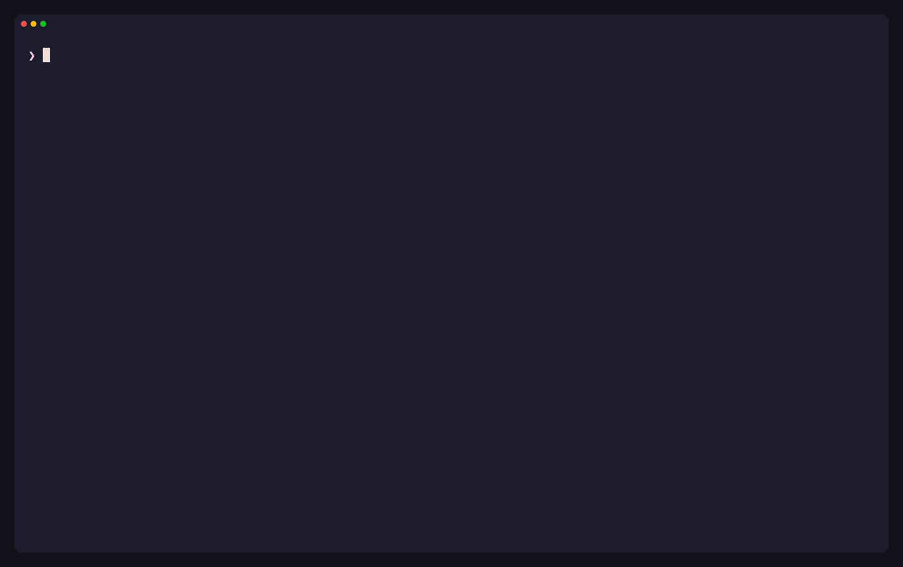
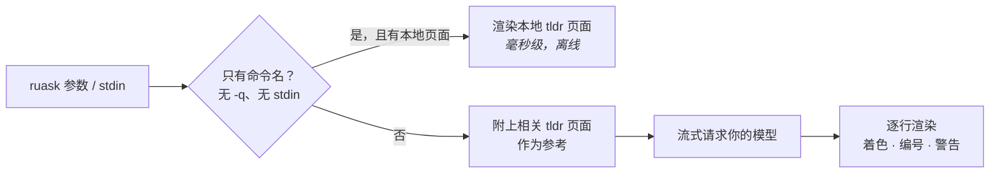

<div align="center">

<a href="https://ruask.vercel.app">
  <picture>
    <source media="(prefers-color-scheme: dark)" srcset="site/public/brand/ruask-wordmark-dark.svg">
    
  </picture>
</a>

<h3>在终端里问命令怎么用。</h3>

<p>简短命令毫秒级显示本地 tldr 页面；其他问题带着参考文档，流式询问你配置的模型。</p>

<p>
  <a href="https://ruask.vercel.app"></a>
  <a href="https://github.com/KevinGuo1007/ruask/stargazers"></a>
  <a href="https://github.com/KevinGuo1007/ruask/commits/main"></a>
  <a href="#许可证"></a>
  <a href="https://doc.rust-lang.org/edition-guide/rust-2024/index.html"></a>
  
</p>

<p>
  <a href="README.md">English</a> · <b>简体中文</b>
  &nbsp;|&nbsp;
  <a href="#快速开始">快速开始</a> ·
  <a href="#常用示例">常用示例</a> ·
  <a href="#配置">配置</a> ·
  <a href="docs/reference.md">行为参考</a>
</p>



</div>

<br>

## 为什么是 ruask

|  |  |
| --- | --- |
| ⚡ **简短命令毫秒级** | `ruask tar`、`ruask git commit` 直接显示本地 tldr 页面：不联网、不调用模型、不需要密钥。 |
| 📚 **带着文档问模型** | `ruask git commit -q "如何修改上一次提交信息"` 这类问题会把相关 tldr 页面作为参考交给模型，减少编造选项。 |
| 🔍 **解释命令输出** | `cat error.log \| ruask cargo build -q "为什么失败"` 同时结合输出、命令和你的问题来回答。 |
| 🖥️ **为终端而做** | 流式逐字显示、按语义着色、示例编号、命令从不折行；重定向时输出纯文本。 |
| 🛡️ **默认安全** | 只显示命令、从不执行；常见不可逆命令（`rm -r`、`git reset --hard`、`git push --force` 等）本地标注警告；不保留历史，不读取项目里的 `.env`。 |
| 🔌 **自带模型** | 支持 OpenAI 兼容 Chat Completions 和 Anthropic 原生 Messages，按用户配置一次即可。 |

## 快速开始

需要支持 Rust 2024 edition 的 Rust 工具链，支持 macOS 和 Linux。

```sh
cargo install --git https://github.com/KevinGuo1007/ruask

ruask --update-pages      # 可选但推荐：下载并校验官方 tldr 页面
ruask tar                 # 本地页面直出，无需任何配置

ruask --init-config       # 创建权限为 0600 的配置模板并显示路径
# 填入模型服务的 base_url、api_key 和 model 后：
ruask "如何查找大于 100 MB 的文件"
```

<details>
<summary>从源码目录构建</summary>

```sh
git clone https://github.com/KevinGuo1007/ruask
cd ruask
cargo install --path .    # 或：cargo build --release && ./target/release/ruask
```

确保 Cargo 的二进制目录（通常是 `~/.cargo/bin`）在 `PATH` 中。

</details>

## 工作方式



`ruask --update-pages` 把页面安装到 `$RUASK_TLDR_DIR`，未设置时为 `$XDG_DATA_HOME/ruask/tldr` 或 `~/.local/share/ruask/tldr`，只保留英文和简体中文页面；也可以用 `--from ./tldr.zip` 离线安装。没有安装页面时，所有查询照常交给模型。

## 常用示例

| 命令 | 效果 |
| --- | --- |
| `ruask cargo` | 查询命令 |
| `ruask git commit` | 查询子命令（多个位置参数会拼接） |
| `ruask "如何查看占用 8080 端口的进程"` | 自然语言任务 |
| `ruask git commit -q "如何撤销提交"` | 命令加附带问题 |
| `ruask --question "如何实时查看日志文件"` | 单独提问 |
| `cat error.log \| ruask cargo build -q "为什么失败"` | 解释管道输入（上限 64 KiB） |
| `ruask tar -xzvf` | 命令词之后 ruask 不认识的选项属于目标命令 |
| `ruask -- git log -p` | 目标选项与 ruask 选项重名时用 `--` 或引号 |
| `ruask -L zh -p linux "查看磁盘占用"` | 指定回答语言（`en` / `zh`）和目标平台（`linux` / `macos`） |
| `ruask git status > usage.txt` | stdout 只有回答，且是纯文本 |
| `ruask --version` | 版本与本地 tldr 页面状态 |

`ruask -h` 显示简短帮助，`ruask --help` 显示完整帮助。

## 配置

`ruask --init-config` 创建 `$XDG_CONFIG_HOME/ruask/config.toml`（默认 `~/.config/ruask/config.toml`），权限为 `0600`，已有文件保持不变。

```toml
api_type = "openai"          # 或 "anthropic"
# language = "zh"            # en / zh；未设置时跟随 locale，再回退英文

[openai]
base_url = "https://your-provider.example/v1"   # 程序在后面追加 /chat/completions
model = "your-model"
api_key = "YOUR_API_KEY"
# thinking = "disabled"      # 仅适用于支持 thinking.type 的服务，通常明显更快

[anthropic]
base_url = "https://your-anthropic-provider.example/v1"   # 程序在后面追加 /messages
model = "your-model"
api_key = "YOUR_API_KEY"
```

环境变量按所选协议逐字段覆盖配置文件，不会向另一组协议借用：

| 协议 | 环境变量 |
| --- | --- |
| 选择协议 | `RUASK_API_TYPE`（`openai` / `anthropic`） |
| `openai` | `OPENAI_BASE_URL`、`OPENAI_API_KEY`、`OPENAI_MODEL`、`OPENAI_THINKING` |
| `anthropic` | `ANTHROPIC_BASE_URL`、`ANTHROPIC_API_KEY`、`ANTHROPIC_MODEL`、`ANTHROPIC_WORKSPACE_ID` |

ruask 不读取项目目录里的 `.env`，也不修改 shell 启动文件。流式回退规则、Anthropic 请求头等完整说明见[行为参考](docs/reference.md)。

## 输出与退出码

- **stdout** 只有回答；**stderr** 放提醒、等待提示和来源标识（模型 · 耗时 · 参考的 tldr 页面）。
- 颜色由 `--color auto|always|never` 和 `NO_COLOR` 控制。`{{file}}` 这类占位符在终端里显示为斜体下划线，重定向时保留原文。
- 已经开始输出后断流，会保留已显示内容并以退出码 `5` 结束，不重试也不重放。

| 退出码 | 含义 |
| :-: | --- |
| `0` | 成功 |
| `1` | 其他错误 |
| `2` | 用法或输入错误 |
| `3` | 配置错误 |
| `4` | 无法连接或服务返回错误 |
| `5` | 回答不完整 |

## 文档

- [行为参考](docs/reference.md)：协议、流式、配置、输入输出约定的完整说明
- [开发指南](docs/development.md) · [测试说明](docs/testing.md) · [性能说明](docs/performance.md)
- [官网](https://ruask.vercel.app)，附 20 秒发布视频

## 开发

```sh
cargo test
cargo fmt --check
cargo clippy --all-targets -- -D warnings
```

测试不需要真实模型密钥，会在本机随机端口启动 HTTP 替身；macOS/Linux 上的颜色测试还会创建伪终端。官网源码在 [`site/`](site/README.md)（Vite + React），推送 `main` 后由 Vercel 自动部署。

尚未发布到 crates.io，也没有 Homebrew 配方或预编译二进制；暂不支持 Windows。

## 许可证

ruask 以 [MIT](LICENSE-MIT) 或 [Apache-2.0](LICENSE-APACHE) 双许可证发布，任选其一。

除非你明确声明，否则你有意提交给本项目的任何贡献，均按 Apache-2.0 许可证的定义，以上述双许可证授权，不附加任何其他条款或条件。

本地页面内容来自 [tldr-pages](https://github.com/tldr-pages/tldr)，按 [CC BY 4.0](https://creativecommons.org/licenses/by/4.0/) 许可使用，不随 ruask 分发。
